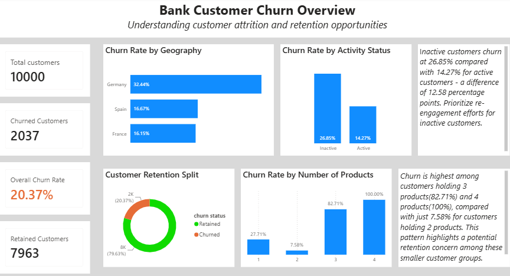
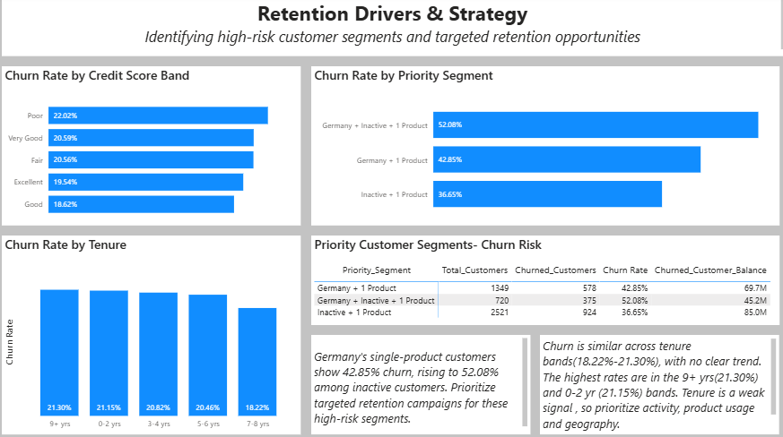

# Bank Customer Churn Analysis

## Project Overview

This project analyzes customer churn in a banking dataset using **MySQL and Power BI** to identify churn patterns, understand customer behavior, and highlight high-risk customer segments. The analysis translates customer data into actionable retention strategies.

## Business Problem

Customer churn can affect long-term customer relationships and banking revenue. The objective is to identify which customer groups show higher churn rates and recommend targeted retention actions.

## Tools & Technologies

* **MySQL:** Data validation, SQL-based analysis, customer segmentation, and views.
* **Power BI:** Interactive dashboard, DAX measures, KPI tracking, and visual analysis.

## Dataset Overview

The project uses the Maven Analytics Bank Customer Churn dataset, containing **10,000 customer records** and attributes related to demographics, account activity, product usage, credit scores, balances, and churn status.

Key fields include Geography, Age, Tenure, Credit Score, Number of Products, Account Balance, Active Member Status, and Exited.

## Key Analysis & Findings

* **Overall churn:** 2,037 of 10,000 customers churned (**20.37%**); 7,963 were retained.
* **Geography:** Germany had the highest churn rate at **32.44%**, compared with Spain at 16.67% and France at 16.15%.
* **Customer activity:** Inactive customers churned at **26.85%** versus **14.27%** for active customers, a gap of 12.58 percentage points.
* **Product usage:** Churn was 27.71% for customers with one product and 7.58% for those with two products. Churn was far higher for customers with three products (82.71%) and four products (100%), but these groups are small (n = [add count] and n = [add count]), so the rates should be read with caution. This also shows that more products do not automatically mean lower churn.
* **Priority segments:** The segments below are overlapping groups, not separate ones.

| Segment | Customers | Churned | Churn Rate |
|---|---|---|---|
| Germany + Inactive + 1 Product | 720 | 375 | 52.08% |
| Germany + 1 Product | 1,349 | 578 | 42.85% |
| Inactive + 1 Product | 2,521 | 924 | 36.65% |

* **Credit score:** Churn ranged only from 18.62% (Good) to 22.02% (Poor), and the order was not a clean progression. Credit score alone does not strongly distinguish churn risk.
* **Tenure:** Churn ranged from 18.70% to 21.15% across tenure bands, with the highest rate in the 0-2 year band (21.15%). The differences are small, so tenure is a weak signal in this dataset.

## Power BI Dashboard

### Page 1: Customer Churn Overview

KPI cards and visuals covering:

* Total customers, churned customers, retained customers, and overall churn rate.
* Churn rate by geography.
* Churn rate by activity status.
* Churn rate by number of products.
* Customer retention split.

### Page 2: Retention Drivers & Strategy

* Churn rate by credit score band.
* Churn rate by tenure band.
* Churn rate by priority segment.
* Priority segment table with customer counts, churned customers, and churn rate.

## Business Recommendations

Listed in suggested priority order, based on both churn rate and the number of customers affected.

1. **Re-engage inactive single-product customers:** This segment has the most churned customers (924 of 2,521) and a 36.65% churn rate. Test personalized communication and engagement campaigns.
2. **Prioritize Germany:** Germany's single-product customers churn at 42.85%, rising to 52.08% among inactive ones. Investigate the reasons and test localized retention strategies.
3. **Review product mix carefully:** One-product customers churn more than two-product customers, but three- and four-product customers churn much more. Understand why before pushing cross-selling.
4. **Test early-tenure engagement at low priority:** The 0-2 year band shows slightly higher churn (21.15%), but the difference from other bands is small. Treat onboarding support as a low-cost experiment, not a main driver.
5. **Monitor high-risk segments:** Track churn rates and retention outcomes to evaluate whether interventions work.

## Project Workflow

1. Inspect and validate the customer dataset using SQL.
2. Analyze overall churn and customer-level patterns.
3. Create customer segmentation fields and a reusable SQL view.
4. Build DAX measures and interactive Power BI visuals.
5. Translate findings into targeted retention recommendations.

## Conclusion

Geography, customer activity, and product usage are the most useful dimensions for investigating churn in this dataset. Credit score and tenure show little separation. The results support targeted retention experiments and ongoing monitoring rather than a one-size-fits-all strategy.

## Disclaimer

This project is for analytical and portfolio purposes. The findings describe associations within the dataset and do not establish causation. Churned-customer balances should not be interpreted as direct financial losses.
